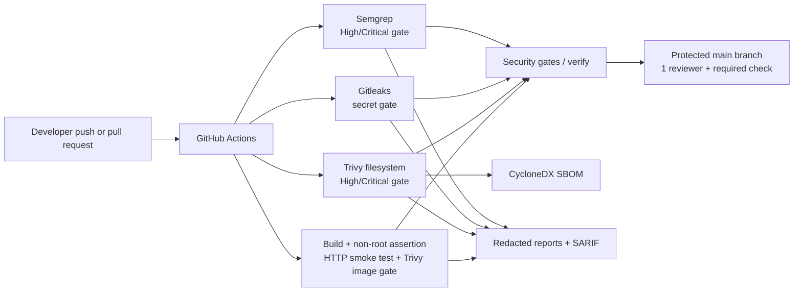

# Acme Financial Services — DevSecOps pipeline

A complete interview submission for securing an existing GitHub Actions delivery path around OWASP Juice Shop. Juice Shop is a pinned, unmodified submodule; the controls, documentation, tests, and evidence are owned by this repository.

> **Safety:** Juice Shop is intentionally vulnerable. Run it only on an isolated local or CI runner, bind it to loopback, and never attach production credentials or data.

## Deliverables

| Challenge deliverable | Location |
| --- | --- |
| One-page risk brief | `docs/risk-brief.md` |
| Working pipeline | `.github/workflows/security.yml` |
| Hardened Dockerfile and comparison | `Dockerfile`, `docs/dockerfile-comparison.md` |
| Custom static-analysis rules and tests | `security/semgrep/rules.yml`, `security/semgrep/tests/` |
| Phased rollout | `docs/rollout-plan.md` |
| Presentation | `presentation/devsecops-presentation.pptx`, `presentation/devsecops-presentation.pdf` |
| Written reflection | `docs/reflection.md` |
| Live demonstration and Q&A | `docs/demo-runbook.md`, `presentation/speaker-notes.md` |
| Verification ledger | `docs/evidence.md` |

## Architecture



The four scan jobs run independently so a failure in one does not suppress the other results. The aggregate `verify` job is the single required check. A scheduled workflow also scans Git history, and scheduled security scans surface newly disclosed vulnerabilities in unchanged code.

## Security gates

| Control | Tool and pinned version | Scope | Blocking rule | Evidence |
| --- | --- | --- | --- | --- |
| Static application security testing | Semgrep 1.185.0 | Juice Shop JavaScript/TypeScript; custom + registry rules | Semgrep `ERROR` findings, mapped to High in custom metadata | JSON, SARIF, text, job summary |
| Secrets | Gitleaks 8.30.1, digest-pinned image | Current repository tree including submodule | Any confirmed-pattern detection | Redacted JSON and job summary |
| Software composition analysis | Trivy 0.76.2 | Ephemeral exact-version npm lockfiles | High/Critical, including unfixed findings | JSON, SARIF, table |
| Software bill of materials | Syft 1.57.1 | Resolved application dependencies | Generation must succeed | CycloneDX JSON |
| Container | Docker + Trivy 0.76.2 | Exact hardened image; operating system and application packages | High/Critical vulnerabilities; build, non-root, and HTTP checks must succeed | JSON, SARIF, table, smoke log |
| Prevention | GitHub branch protection + CODEOWNERS | Main branch | One approval and `Security gates / verify`; stale reviews dismissed | API response in `docs/evidence/` |

A vulnerable target means a failing gate is a valid demonstration. Do not add genuine findings to an ignore file merely to obtain a green pipeline. The organizational rollout explains how to warn, baseline, and then enforce without permanently blocking every legacy service.

## Reproduce locally

### Checkout

```bash
git clone --recurse-submodules https://github.com/roger737/devsecops.git
cd devsecops
git submodule status
```

The expected Juice Shop commit is `266448aba68cd8ba5915f526a128da4fa7bc3f9f`.

### Custom static-analysis tests

With Python 3.12 available:

```bash
python -m pip install --requirement security/requirements.txt
semgrep scan --test --config security/semgrep/rules.yml security/semgrep/tests
semgrep scan --config security/semgrep/rules.yml --metrics=off --error security/semgrep/examples/false-positive.ts
```

The tests include vulnerable and safe parameterized/restricted-origin cases. `security/exceptions.md` explains suppression, ownership, approval, and expiry. `.gitleaks.toml` narrowly exempts only the known upstream private-key training fixtures. `security/gitleaks-baseline.json` records 72 redacted, exact-fingerprint findings in the intentionally vulnerable training target; the current-tree gate fails on any additional secret. Regenerate and review that baseline only through the documented risk-acceptance process, never to hide a new leak.

Run the supporting checks before publishing changes:

```bash
python scripts/check_exception_expiry.py security juice-shop
python -m unittest discover -s scripts/tests -v
python scripts/validate_repository.py
python scripts/validate_repository.py --require-live  # after recording real evidence
```

The validator needs `scripts/presentation-requirements.txt`. Workflow files are also checked with `actionlint` in the development environment; scanner and container authority comes from the real GitHub Actions runs.

### Hardened image

```bash
docker build --file Dockerfile --tag juice-shop:hardened juice-shop
docker run --detach --name juice-shop \
  --cap-drop ALL --security-opt no-new-privileges \
  --publish 127.0.0.1:3000:3000 juice-shop:hardened
curl --fail http://127.0.0.1:3000/
docker logs juice-shop
docker rm --force juice-shop
```

The HTTP check and build are also performed by GitHub Actions. See `docs/dockerfile-comparison.md` for honest upstream-versus-submission differences and the lockfile limitation.

### Secret demonstration

Follow `docs/demo-runbook.md`. Use only the supplied synthetic-credential procedure on a test branch. Never place a real credential in a commit, issue, screenshot, chat, or report.

### Branch protection

Authenticate GitHub CLI as a repository administrator, then apply and verify the rules:

```bash
bash scripts/configure_branch_protection.sh roger737/devsecops
```

The script applies and reads back the settings. It does not store a token. Free private repositories may not support every branch-protection feature; use a public repository or an eligible plan.

## Presentation regeneration

The generated PowerPoint and PDF are committed. To regenerate after adding evidence:

```bash
python -m venv scripts/.venv
scripts/.venv/Scripts/python -m pip install --requirement scripts/presentation-requirements.txt  # Windows
scripts/.venv/bin/python -m pip install --requirement scripts/presentation-requirements.txt      # Linux/macOS
python scripts/build_presentation.py
```

Use the active virtual environment's Python if the final command does not find the packages. The script validates slide counts and writes timed speaker notes.

## Limitations

This repository demonstrates delivery controls; it does not modify Acme's real cloud roles, secrets manager, web firewall, denial-of-service protection, or production browser-origin policy. Static pattern rules are not full data-flow analysis, a software bill of materials is not a vulnerability fix, and a running container is not a secure application. `docs/reflection.md` covers these trade-offs and follow-up work.
